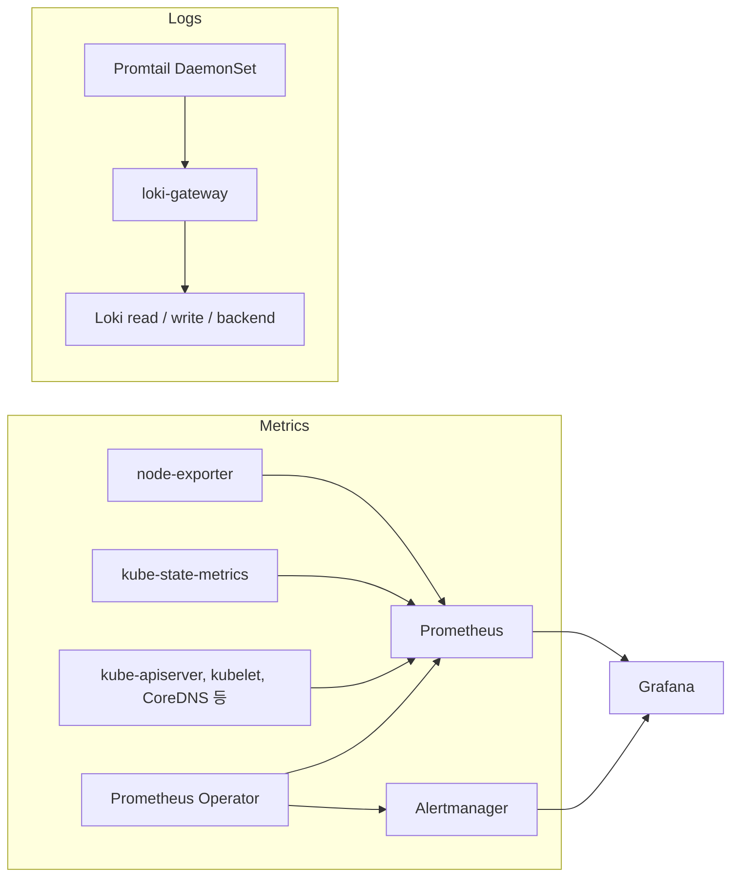

# platform-prometheus-stack

[](https://helm.sh)
[](https://kubernetes.io)
[](https://prometheus.io)
[](https://github.com/prometheus-operator/prometheus-operator)
[](https://grafana.com)
[](https://grafana.com/oss/loki/)
[](https://grafana.com/docs/loki/latest/send-data/promtail/)

kube-prometheus-stack에 Loki, Promtail, metrics-server를 로컬 서브차트로 묶고, Grafana에 커스텀 대시보드 JSON을 넣은 Helm 차트입니다.

차트 이름은 `platform-prometheus-stack`, 버전은 `69.3.1`, `Chart.yaml`의 `appVersion`은 `v0.80.0`입니다. 기반은 [prometheus-community/kube-prometheus-stack](https://github.com/prometheus-community/helm-charts)과 [Prometheus Operator](https://github.com/prometheus-operator/kube-prometheus)입니다.

## 배경과 목적

Kubernetes 클러스터의 메트릭 수집과 로그 수집을 한 차트 디렉터리에서 설치하기 위한 패키징입니다.

업스트림 `kube-prometheus-stack`을 받아 서브차트를 `charts/`에 풀어 두고, `Chart.yaml` 의존성을 `file://`로 고정했습니다. 그 위에 Grafana Helm 차트의 Loki `5.43.0`, Promtail `6.15.0`, metrics-server `3.8.0`을 의존성으로 추가했습니다. Grafana 서브차트에는 대시보드 JSON 하나를 file provisioning으로 연결했습니다.

이 저장소는 차트 소스와 작업 중 남긴 설치 명령을 담습니다. CI, Kind 설정 파일, 설치 결과 스크린샷은 없습니다.

## 구성

메트릭은 Prometheus Operator가 Prometheus와 Alertmanager를 만들고, node-exporter와 kube-state-metrics, Kubernetes 컴포넌트 ServiceMonitor가 Prometheus로 들어옵니다. Grafana datasource sidecar는 Prometheus와 Alertmanager를 기본 datasource로 등록합니다.

로그는 Promtail DaemonSet이 `loki-gateway` Service로 보내고, Loki는 read / write / backend로 나뉩니다. 부모 `values.yaml`에는 Loki datasource 정의가 없습니다.



`metrics-server` 서브차트는 의존성에 포함되어 있습니다. 자체 `serviceMonitor.enabled`는 `false`입니다. `prometheus-windows-exporter`도 차트에 있지만 부모 값 `windowsMonitoring.enabled`가 `false`라 기본 설치에서는 빠집니다. ThanosRuler 이미지 태그는 values에 있으나 `thanosRuler.enabled`는 `false`입니다.

### 차트에 적힌 버전

이미지 크기나 런타임 측정값은 차트에 없습니다. 아래는 `Chart.yaml`, `Chart.lock`, 각 `values.yaml`에 있는 태그입니다.

| 구성 | 워크로드 | 이미지 | 차트 |
| --- | --- | --- | --- |
| Prometheus Operator | Deployment | `quay.io/prometheus-operator/prometheus-operator:v0.78.2` | 부모 차트 `69.3.1` (`appVersion`은 `v0.80.0`) |
| Prometheus config reloader | Operator가 주입 | `quay.io/prometheus-operator/prometheus-config-reloader:v0.78.2` | 같은 부모 values |
| Prometheus | Prometheus CR, replicas 1, retention `10d` | `quay.io/prometheus/prometheus:v2.55.1` | 부모 values. `storageSpec`은 비어 있음 |
| Alertmanager | Alertmanager CR, replicas 1, retention `120h` | `quay.io/prometheus/alertmanager:v0.28.0` | 부모 values |
| Grafana | Deployment. Service `80` → container `3000` | `docker.io/grafana/grafana:11.3.1` | grafana `8.9.1` |
| Grafana sidecar | Grafana Pod의 sidecar | `quay.io/kiwigrid/k8s-sidecar:1.28.0` | grafana values |
| node-exporter | DaemonSet | `quay.io/prometheus/node-exporter:v1.8.2` | prometheus-node-exporter `4.43.1` |
| kube-state-metrics | Deployment | `registry.k8s.io/kube-state-metrics/kube-state-metrics:v2.14.0` | kube-state-metrics `5.29.0` |
| Loki | read Deployment, write/backend StatefulSet. 각 replicas 3 | `docker.io/grafana/loki:2.9.4` (`tag`가 비어 있어 chart `appVersion`) | loki `5.43.0` |
| Loki gateway | Deployment, replicas 1 | `docker.io/nginxinc/nginx-unprivileged:1.24-alpine` | loki values |
| Loki sidecar | Loki Pod sidecar | `kiwigrid/k8s-sidecar:1.24.3` | loki values |
| Loki canary | DaemonSet. `monitoring.lokiCanary.enabled: true` | `docker.io/grafana/loki-canary`, tag는 chart `appVersion` `2.9.4` | loki values |
| Grafana Agent Operator | Loki self-monitoring. `installOperator: true` | `grafana/agent-operator:v0.39.1` | grafana-agent-operator `0.3.15` |
| Promtail | DaemonSet | `docker.io/grafana/promtail:3.0.0` | promtail `6.15.0`. chart `appVersion`은 `2.8.3` |
| metrics-server | Deployment, replicas 1 | `k8s.gcr.io/metrics-server/metrics-server:v0.6.0` | metrics-server `3.8.0` |

Loki 차트 설명은 simple scalable mode입니다. `singleBinary.replicas`는 `0`, `read.legacyReadTarget`은 `false`입니다. `commonConfig.replication_factor`는 `3`이고 write/read/backend PVC는 각 `10Gi`입니다.

## 디렉터리 구조

최상위는 README와 차트 디렉터리뿐입니다. 서브차트는 풀린 디렉터리와 `.tgz`가 같이 있습니다. 부모 차트 패키지 `platform-prometheus-stack-69.3.1.tgz`는 현재 트리에 없습니다.

```text
.
├── README.md
└── kube-prometheus-stack/
    ├── Chart.yaml          # name: platform-prometheus-stack, version: 69.3.1
    ├── Chart.lock          # generated: 2025-02-19
    ├── values.yaml
    ├── .helmignore
    ├── templates/          # Operator, Prometheus, Alertmanager, exporter ServiceMonitor, 기본 Grafana 대시보드/룰
    │   ├── alertmanager/
    │   ├── exporters/      # kube-apiserver, kubelet, kube-proxy, kube-scheduler, kube-controller-manager, kube-etcd, CoreDNS, kube-dns
    │   ├── grafana/
    │   ├── prometheus/
    │   ├── prometheus-operator/
    │   └── thanos-ruler/
    └── charts/
        ├── crds/
        ├── grafana/                      # dashboards/test/test-dashboard.json
        ├── grafana-8.9.1.tgz
        ├── kube-state-metrics/
        ├── kube-state-metrics-5.29.0.tgz
        ├── loki/                         # charts/ 아래 grafana-agent-operator, minio
        ├── loki-5.43.0.tgz
        ├── metrics-server/
        ├── metrics-server-3.8.0.tgz
        ├── prometheus-node-exporter/
        ├── prometheus-node-exporter-4.43.1.tgz
        ├── prometheus-windows-exporter/
        ├── prometheus-windows-exporter-0.8.0.tgz
        ├── promtail/
        └── promtail-6.15.0.tgz
```

`Chart.yaml` 의존성입니다. `crds`만 repository가 비어 있고, 나머지는 `file://charts/<name>`입니다.

| name | version | condition |
| --- | --- | --- |
| crds | `0.0.0` | `crds.enabled` |
| kube-state-metrics | `5.29.*` (lock `5.29.0`) | `kubeStateMetrics.enabled` |
| prometheus-node-exporter | `4.43.*` (lock `4.43.1`) | `nodeExporter.enabled` |
| grafana | `8.9.*` (lock `8.9.1`) | `grafana.enabled` |
| prometheus-windows-exporter | `0.8.*` (lock `0.8.0`) | `windowsMonitoring.enabled` |
| loki | `5.43.0` | `loki.enabled` |
| promtail | `6.15.0` | `promtail.enabled` |
| metrics-server | `3.8.0` | `metrics-server.enabled` |

부모 `values.yaml`은 `kubeStateMetrics.enabled`, `nodeExporter.enabled`, `grafana.enabled`를 `true`로 두고 `windowsMonitoring.enabled`를 `false`로 둡니다. `loki`, `promtail`, `metrics-server` 키는 부모 values에 없습니다.

## 사전 요구 사항

- Kubernetes `>=1.19.0-0` (`Chart.yaml` `kubeVersion`)
- Helm 3. 차트 `apiVersion`은 `v2`입니다.
- Loki write/read/backend가 PVC `10Gi`를 요청합니다. `storageClass`는 `null`이라 클러스터 기본 StorageClass를 사용합니다. Prometheus `storageSpec`은 비어 있습니다.
- 원격 차트를 다시 받을 때만 Helm repo가 필요합니다. 이 트리의 의존성은 이미 `charts/`에 있습니다.

작업 메모에 남은 테스트 환경은 Kind `v0.26.0` (`go1.23.4`, `darwin/arm64`)과 Kubernetes `v1.30.2`입니다. Kind 설정 파일은 저장소에 없습니다.

## 설치와 사용

명령은 저장소에 적혀 있던 절차입니다. 메모에는 서로 다른 설치가 섞여 있습니다. 아래는 그 차이를 유지한 채, 지금 트리에서 실행할 수 있는 순서로 정리한 것입니다.

### 1. 이 저장소의 차트 배포

```bash
cd kube-prometheus-stack
helm dependency list
helm install prometheus . --namespace monitoring --create-namespace
```

메모에 남은 디렉터리 설치 명령은 namespace 플래그 없이 `helm install prometheus .`입니다. 그 출력의 namespace는 `monitoring`, revision은 `1`, chart는 `platform-prometheus-stack-69.3.1`, app version은 `v0.80.0`이었습니다. namespace를 만드는 플래그는 다른 줄의 tgz 설치 명령에 있었습니다.

```bash
helm install platform-monitoring kube-prometheus-stack-69.3.1.tgz --namespace monitoring --create-namespace
```

지금 `Chart.yaml`의 `name`은 `platform-prometheus-stack`입니다. `kube-prometheus-stack/`에서 `helm package .`를 하면 파일 이름은 `platform-prometheus-stack-69.3.1.tgz`입니다. 메모 앞부분의 `kube-prometheus-stack-69.3.1.tgz`는 차트 이름을 바꾸기 전 패키지 이름으로 보입니다. 그 tgz는 현재 트리에 없습니다.

패키지한 뒤 상태를 볼 때 메모에 있던 명령입니다.

```bash
helm package .
helm list
kubectl get pods -n monitoring
watch -d 'kubectl get pods'
kubectl get pods -o jsonpath="{.items[*].spec.containers[*].image}" | tr ' ' '\n'
```

### 2. 업스트림 차트를 다시 받을 때

이미 vendoring된 트리를 설치할 때는 거치지 않습니다. 메모에 있던 가져오기 명령입니다.

```bash
helm repo add prometheus-community https://prometheus-community.github.io/helm-charts
helm repo update
helm pull prometheus-community/kube-prometheus-stack --untar
helm show values prometheus-community/kube-prometheus-stack > values.yaml
```

Loki와 Promtail을 넣은 뒤 메모에 있던 의존성 명령입니다.

```bash
cd kube-prometheus-stack
helm dependency update
helm dependency list
```

그 `helm dependency list` 출력은 `kube-state-metrics`, `prometheus-node-exporter`, `grafana`, `prometheus-windows-exporter`, `loki`, `promtail`의 repository가 `https://prometheus-community.github.io/helm-charts` 또는 `https://grafana.github.io/helm-charts`로 되어 있습니다. 지금 커밋된 `Chart.yaml`과 `Chart.lock`의 repository는 `file://charts/...`입니다. metrics-server는 그 목록 출력에 없고, 이후 커밋에서 `Chart.yaml`에 추가되어 있습니다.

### 3. Grafana 접속

메모의 release 이름이 `prometheus`일 때 사용한 명령입니다. release 이름이 다르면 Secret과 Service 이름도 달라집니다.

```bash
kubectl --namespace monitoring get secrets prometheus-grafana -o jsonpath="{.data.admin-password}" | base64 -d ; echo

kubectl get svc -n monitoring | grep grafana
kubectl port-forward svc/prometheus-grafana 3000:80
```

Grafana Service 포트는 `80`, container `targetPort`는 `3000`입니다. 위 port-forward는 로컬 `3000`을 Service 포트 `80`에 붙입니다. 메모의 출력은 `Forwarding from 127.0.0.1:3000 -> 3000`이었습니다. 사용자 계정 키는 부모 values의 `grafana.adminUser: admin`입니다. 비밀번호는 Secret에서 읽습니다.

Ingress는 `grafana.ingress.enabled: false`입니다.

### 4. 커스텀 대시보드

실제로 연결된 파일은 `kube-prometheus-stack/charts/grafana/dashboards/test/test-dashboard.json`입니다. 대시보드 제목은 `Merged Kubernetes Dashboard`, uid는 `N9uZBy8Wz`, Grafana 버전 표기는 `11.3.1`입니다. 패널은 Prometheus datasource를 쓰며, namespace 메모리, etcd, kubelet, 노드, API server 상태를 포함합니다.

같은 제목과 uid의 `charts/grafana/dashboards/custom-dashboard.json`도 있지만, values에서 그 경로를 가리키는 항목은 주석입니다.

Grafana 서브차트 `values.yaml`에 들어 있는 provisioning입니다.

```yaml
dashboardProviders:
  dashboardproviders.yaml:
    apiVersion: 1
    providers:
    - name: 'test-dashboard'
      orgId: 1
      folder: TEST
      type: file
      disableDeletion: false
      editable: true
      options:
        path: /var/lib/grafana/dashboards/test-dashboard

dashboards:
  test-dashboard:
    TEST:
      file: dashboards/test/test-dashboard.json
```

부모 `values.yaml`은 이와 별도로 Grafana dashboard sidecar를 켭니다.

```yaml
grafana:
  defaultDashboardsEnabled: true
  sidecar:
    dashboards:
      enabled: true
      label: grafana_dashboard
      labelValue: "1"
      searchNamespace: ALL
```

kube-prometheus-stack이 만드는 기본 대시보드 ConfigMap과, Loki 차트의 `monitoring.dashboards.enabled: true` ConfigMap은 라벨 `grafana_dashboard: "1"`을 사용합니다.

대시보드 JSON을 서브차트에 넣은 뒤 메모에 있던 재패키징 순서입니다. 경로는 차트 루트 `kube-prometheus-stack/` 기준입니다.

```bash
cd charts/grafana
helm package .
mv grafana-8.9.1.tgz ..
cd ../..
helm install prometheus .
```

## 설정 메모

- Grafana 서브차트에 대시보드를 더 넣을 때는 `dashboardProviders`의 `path`가 `/var/lib/grafana/dashboards/<provider name>`이어야 합니다. `dashboards`의 첫 키는 provider 이름과 같아야 하고, `file`은 차트 안의 상대 경로입니다.
- 부모 차트는 Prometheus datasource 이름 `Prometheus`, uid `prometheus`, Alertmanager datasource를 sidecar로 만듭니다. Loki를 Grafana datasource로 등록하는 값은 없습니다.
- Promtail 기본 client는 `http://loki-gateway/loki/api/v1/push`입니다. gateway Service 이름은 `loki-gateway`이고, 템플릿은 release 이름을 붙이지 않습니다. 같은 namespace의 짧은 DNS 이름과 맞습니다.
- Loki `loki.storage.type`은 `s3`이고 `endpoint`, `region`, `accessKeyId`, `secretAccessKey`는 `null`입니다. `minio.enabled`는 `false`입니다. `loki.auth_enabled`는 `true`이고 `loki.tenants`는 비어 있습니다. gateway `basicAuth.enabled`는 `false`입니다.
- `monitoring.selfMonitoring.enabled`와 `monitoring.lokiCanary.enabled`는 `true`입니다. Loki chart의 `test.enabled`도 `true`이고, `test.prometheusAddress`는 `http://prometheus:9090`입니다.
- node-exporter는 부모 values에서 Linux, AIX, Darwin 수집이 켜져 있고, mountpoint와 fstype exclude 인자가 들어 있습니다.
- `.helmignore`는 패키징 시 `README.md`, `ci/`, `kube-prometheus-*.tgz` 등을 제외합니다.

## 트러블슈팅

차트와 작업 메모를 대조하면 아래가 드러납니다. 코드를 고쳐 확인한 런타임 증상은 아닙니다.

- **메모의 설치 기록이 한 흐름이 아닙니다.** tgz 설치 release는 `platform-monitoring`입니다. Pod 목록의 이름 접두사는 `platform-kube-prometheus-stac`으로, release `platform`와 당시 차트 이름 `kube-prometheus-stack`을 fullname 26자에 맞춘 형태입니다 (`templates/_helpers.tpl`). 이후 `helm list`는 release `prometheus`, chart `platform-prometheus-stack-69.3.1`입니다. 노드 표에는 control-plane, worker, worker2만 있고 Pod 목록에는 worker3이 있습니다.
- **대시보드 목록이 차트와 다릅니다.** 메모에는 `1.Kubernetes Basic Component`부터 `5.Log Monitoring`까지 다섯 provider와 `dadashboards` 키가 적혀 있습니다. 커밋된 키는 `dashboards`이고, 연결된 JSON은 `test-dashboard` / 폴더 `TEST` 하나입니다. 메모의 `attachment:` 이미지는 저장소에 없습니다.
- **Grafana sidecar와 file provider가 같이 켜져 있습니다.** Grafana 서브차트 주석은 sidecar를 `dashboardProviders`, `datasources`, `dashboards`와 함께 쓰지 않는다고 적습니다. 부모 values는 dashboard sidecar를 `enabled: true`로 두고, 서브차트 values는 `dashboardProviders`를 설정합니다.
- **대시보드 JSON의 datasource uid.** 파일은 Grafana import용 `__inputs`와 `${DS_PROMETHEUS}`를 사용합니다. 부모 차트가 만드는 Prometheus datasource uid는 `prometheus`입니다.
- **Loki 스토리지.** `storage.type: s3`라서 scalable target 조건은 만족합니다. endpoint와 자격 증명은 비어 있고 MinIO 서브차트는 꺼져 있습니다. 스토리지를 filesystem으로 바꾸면서 `singleBinary.replicas`를 0으로 두면 `charts/loki/templates/validate.yaml`이 `Cannot run Scalable targets (backend, read, write) without an object storage backend.`로 렌더를 멈춥니다.
- **kube-etcd ServiceMonitor 키가 두 번 있습니다.** `kube-prometheus-stack/values.yaml`의 `kubeEtcd` 아래에 `serviceMonitor`가 두 번 나옵니다. 앞 블록은 `scheme: https`와 etcd 클라이언트 인증서 경로이고, 뒤 블록은 `enabled: true`, `scheme: http`, 빈 `caFile` / `certFile` / `keyFile`입니다.
- **kube-state-metrics의 NodePort 위치.** `charts/kube-state-metrics/values.yaml`의 `prometheus.monitor` 아래에 `server.type: NodePort`, `nodePort: 30090`이 있습니다. Service 템플릿은 `.Values.service.type`과 `.Values.service.nodePort`를 읽습니다. 부모 values는 `kube-state-metrics.prometheus.monitor.enabled: true`만 덮어씁니다.
- **Promtail 버전 표기.** chart `appVersion`은 `2.8.3`이고 이미지 태그는 `3.0.0`입니다.
- **Helm test와 Prometheus 주소.** Loki `test.prometheusAddress`는 `http://prometheus:9090`으로 고정되어 있습니다. release 이름이 `prometheus`가 아니면 이 주소와 Service 이름이 어긋납니다.

## 업스트림

서브차트 README와 템플릿은 가져온 업스트림 차트입니다. 이 저장소에서 차트 메타데이터와 values에 손으로 들어간 변경은 다음입니다.

- 차트 이름을 `platform-prometheus-stack`으로 변경
- Loki, Promtail, metrics-server를 `file://` 의존성으로 추가
- Grafana `dashboardProviders`와 `dashboards/test/test-dashboard.json`
- `kubeEtcd.serviceMonitor` 예시 블록을 주석 밖으로 이동
- kube-state-metrics `prometheus.monitor`에 `server` 항목 추가
